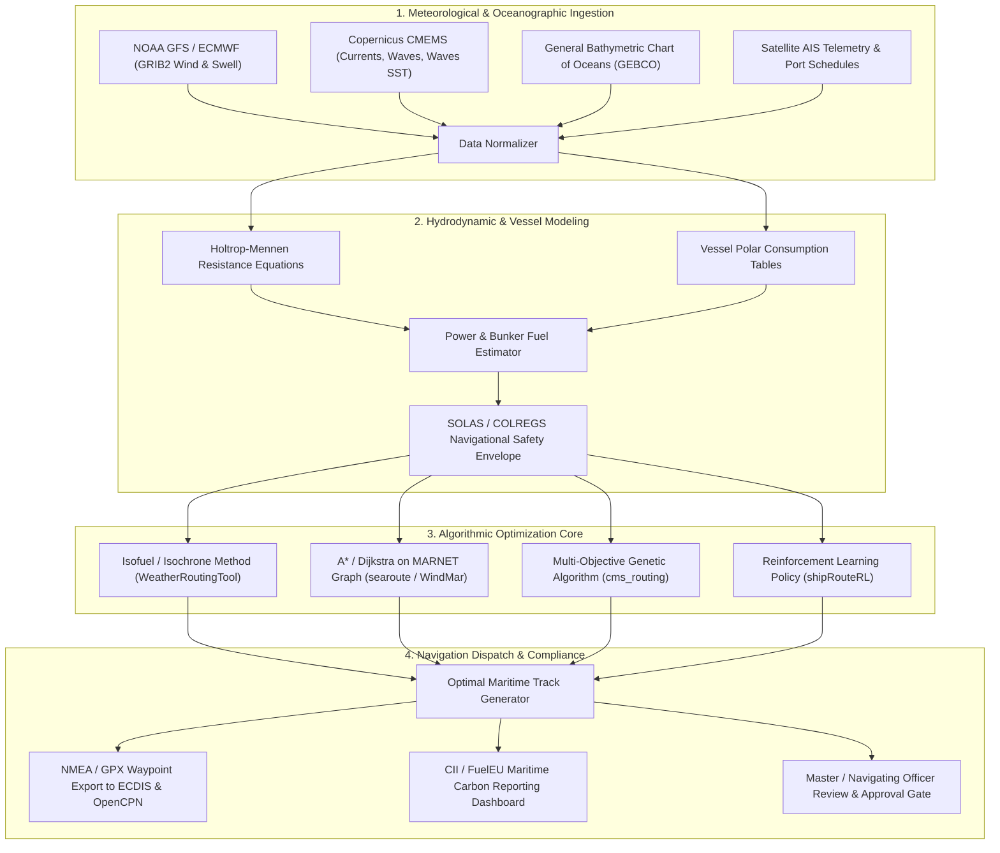

  

  
  
  
  
  
  
  

---

# 🚢 Awesome Marine Freight Route Optimization Engines

> **A curated catalog of commercial SaaS platforms, weather routing engines, voyage analytics suites, and open-source maritime navigation solvers for cargo ships, bulk carriers, tankers, and container fleets.**

**Marine Freight Route Optimization Engines** leverage oceanographic forecasts, meteorological models (GRIB/GRIB2), hydrodynamic vessel resistance physics (such as Holtrop-Mennen and polar speed-consumption curves), and computational graph algorithms (Isofuel, A*, Dijkstra, Genetic Algorithms, Reinforcement Learning) to identify the optimal maritime corridor for commercial ocean voyages. These engines balance fuel consumption (bunker savings), greenhouse gas emissions (CII and FuelEU compliance), navigational safety (SOLAS/COLREGS wave and swell hazards), and strict Just-In-Time (JIT) port arrival schedules.

---

## 📑 Table of Contents

- [🌐 Sector Overview & Market Dynamics](#-sector-overview--market-dynamics)
- [🏢 Enterprise SaaS & Commercial Routing Platforms](#-enterprise-saas--commercial-routing-platforms)
- [💻 Open-Source Routing Solvers & Navigation Libraries](#-open-source-routing-solvers--navigation-libraries)
- [🏗️ Architectural Blueprint for Self-Hosted Routing Systems](#️-architectural-blueprint-for-self-hosted-routing-systems)
- [❓ Frequently Asked Questions (FAQ)](#-frequently-asked-questions-faq)
- [🤝 How to Contribute](#-how-to-contribute)
- [⭐ Star History](#-star-history)
- [💖 Support & Community](#-support--community)
- [⚖️ Disclaimer](#️-disclaimer)

---

## 🌐 Sector Overview & Market Dynamics

The global **maritime route optimization and voyage analytics software market** is currently valued at approximately **$1.35 billion to $1.8 billion** and is projected to expand rapidly past **$5.7 billion by the early 2030s**, exhibiting a robust Compound Annual Growth Rate (CAGR) of **17.4%**. Growth is intensely accelerated by volatile marine bunker fuel markets, stringent international decarbonization mandates—specifically the International Maritime Organization's (IMO) Carbon Intensity Indicator (**CII**) ratings and the European Union's **FuelEU Maritime** and **EU ETS** regulations—and the need to mitigate severe weather delays caused by changing global climate patterns.

The market structure is **moderately fragmented but undergoing rapid strategic consolidation**. Historical voyage and commercial chartering giants (such as Veson Nautical, backed by Francisco Partners and Pamlico Capital) and maritime data conglomerates (such as Kpler, which acquired MarineTraffic and FleetMon) have consolidated significant market share in enterprise chartering and vessel tracking through aggressive mergers and acquisitions. However, the software layer is **not a winner-take-all monopoly**. Differentiated deep-tech startups—leveraging proprietary in-situ sensor buoys (Sofar Ocean), deep learning digital twins (Bearing AI), or dedicated multi-fuel bunker pricing models (ZeroNorth)—maintain distinct technological advantages. Consequently, modern shipowners and commercial charterers typically adopt **hybrid architectures**, pairing enterprise voyage management systems with specialized dynamic weather routing engines.

---

## 🏢 Enterprise SaaS & Commercial Routing Platforms

The following table compares leading commercial SaaS platforms and maritime intelligence suites. The entries are **sorted in descending order by company size (Valuation / Revenue)**.

| 🏢 Platform / Vendor | 📊 Company Size (Valuation / Revenue) | 💵 Starting Tier Pricing | 🎁 Free Tier / Free Trial Limits | 🔍 Key Capabilities & Voyage Focus |
| :--- | :--- | :--- | :--- | :--- |
| **[MarineTraffic](https://www.marinetraffic.com/)** *(Kpler)* | **$1.5B+ Valuation** / **~$200M Annual Revenue** *(Acquired by Kpler)* | **$17 / month** *(or $14/mo billed annually at $168/yr for Starter Plan)*; Professional plan at **$69 / month** | **Free-forever Basic Account** limited to terrestrial AIS positions only (delayed offshore tracking), search/particulars, and 1 monitored fleet up to **5 vessels**; **7-day free trial** of paid Starter/Professional plans *(credit card verification required)* | Global terrestrial & satellite AIS vessel tracking, port congestion analytics, nautical chart overlays, density mapping, arrival ETA forecasts, and voyage event notifications. |
| **[Veson Nautical](https://www.veson.com/)** | **~$1.0B - $1.2B Valuation** *(Francisco Partners / Pamlico)* / **~$100M+ ARR** | **$1,500 / vessel / month** *(~$18,000/vessel/yr entry IMOS Chartering & Voyage Operations)*; entry modules (Oceanbolt/Q88) start at **$450 / month** | **14-day guided Proof-of-Concept (PoC) pilot** for qualified commercial fleet operators (limited to **3 test vessels** with sample voyage data integration) | Enterprise Integrated Maritime Operations System (IMOS), commercial chartering, bunker procurement management, voyage P&L accounting, and VesselsValue asset valuation models. |
| **[Spire Global](https://spire.com/)** *(NYSE: SPIR)* | **~$380M - $430M Market Cap** / **~$80M Annual Revenue** | **$450 / month** *(Entry developer tier on AWS Marketplace / direct for Maritime 2.0 API)*; dedicated satellite streams from **$1,200 / month** | **14-day free developer sandbox** with an allowance of up to **10,000 API calls** across terrestrial AIS and sample weather forecast models | Low-Earth-orbit satellite constellation tracking, Maritime 2.0 GraphQL API, dynamic global weather forecasts, predictive ocean ETA models, and vessel risk layers. |
| **[Windward](https://windward.ai/)** *(FTV Capital)* | **$270 Million (£216M) Valuation** *(Delisted from AIM)* / **$37.2M ARR** | **$1,200 / month** *(Billed annually at $14,400/yr for entry Commercial Shipping Intelligence module)* | **14-day structured corporate pilot trial** covering up to **10 monitored vessels** with automated compliance and sanctions screening upon sales consultation | Maritime Artificial Intelligence (MAI), automated sanctions and dark-activity compliance, predictive vessel ETAs, route deviation alerts, and carbon risk tracking. |
| **[ZeroNorth](https://zeronorth.com/)** | **~$220M - $250M Valuation** *(A.P. Moller Holding & Cargill)* / **~$40M ARR** | **$100 / vessel / month** *(Billed annually at $1,200/vessel/yr for entry Bunker & Route Optimization package)* | **14-day free trial** of the *Bunker Pricer* module with access to real-time port bunker prices and up to **5 voyage route simulation calculations** | Digital twin voyage optimization, multi-fuel bunker procurement intelligence, CII and emissions tracking, and hull fouling degradation analytics. |
| **[Sofar Ocean](https://www.sofarocean.com/)** | **~$150M - $200M Valuation** *(Series B)* / **~$20M - $25M ARR** *($39M Series B, $50M+ raised)* | **$300 / vessel / month** *(Wayfinder Explore self-service tier)*; Spotter buoy ocean hardware starts at **$1,200 / unit** + $50/mo satellite data subscription | **30-day proof-of-concept fleet pilot** for up to **3 commercial vessels** using noon-report calibration and retrospective voyage hindcasts | *Wayfinder* dynamic routing engine powered by the planetary Spotter ocean buoy network, real-time wave/current assimilation, and voyage fuel optimization. |
| **[Nautilus Labs](https://nautiluslabs.com/)** *(Danelec)* | **~$136M Peak Valuation** *(Acquired by Danelec Marine)* / **Part of ~$150M Tech Group** | **$500 / vessel / month** *(Billed annually at $6,000/vessel/yr for Voyage Optimization & Carbon Reporting)* | **30-day structured Proof-of-Concept (PoC) pilot** for **1 to 2 vessels** with live telemetry sensor hookup and fuel-saving validation report | High-frequency vessel IoT sensor ingestion, machine learning voyage optimization, Speed and Engine Power Optimization (EPO), and EU ETS / FuelEU compliance management. |
| **[Bearing AI](https://www.bearing.ai/)** | **~$40M - $50M Valuation** *(Mitsui & Co. / AI Fund)* / **~$14M - $15M ARR** *($10M raised)* | **$400 / vessel / month** *(Annual fleet subscription commitment)* for AI Fleet Routing & Carbon/CII Engine | **14-day historical voyage simulation trial** evaluating past voyage logs against AI-recommended routes for up to **2 candidate vessels** | Deep neural network vessel performance models, multi-factor route optimization (weather, currents, draft, trim), and predictive voyage CII rating simulators. |
| **[Portcast](https://www.portcast.io/)** | **~$25M - $30M Valuation** / **~$3M - $5M ARR** *($7M+ venture funding raised)* | **$500 / month** *(Billed annually for Container Visibility & Port Congestion Tracker)* | **Free-forever starter tier with 20 complimentary container tracking credits**; or **14-day full platform free trial** including up to **100 container lookups** and AIS tracking | Predictive container ETA forecasting, port congestion telemetry, terminal dwell time alerts, and multi-carrier ocean route visibility. |
| **[Shipfix](https://www.shipfix.com/)** *(Veson Nautical)* | **~$20M - $25M Standalone Valuation** *(Acquired by Veson)* / **~$5M - $8M ARR** | **€250 / user / month (~$275/mo)** billed annually *(Entry Chartering Desk & Email Parsing Tier)* | **14-day guided proof-of-concept sandbox trial** with access for up to **3 commercial operators** and parsing of up to **50 cargo circular emails** | AI natural language processing for maritime circulars, tonnage/cargo order matching, voyage route distance calculator, and forward freight rate sentiment. |

---

## 💻 Open-Source Routing Solvers & Navigation Libraries

The following open-source repositories provide self-hostable pathfinding algorithms, weather routing engines, nautical distance calculators, and benchmark datasets. The list is **sorted strictly in descending order by GitHub Stars_Count**. Each Stars_Badge links directly to the repository's stargazers page.

1. **[OpenCPN/OpenCPN](https://github.com/OpenCPN/OpenCPN)**   
   **The premier open-source ChartPlotter and Marine GPS navigation software.** A cross-platform ship-borne GUI application supporting BSB raster and S57/S63 vector nautical charts, NMEA 0183/2000 input, AIS tracking, and plugin extensibility for integrated weather routing, autopilot interfacing, and radar overlays.  
   `C++` • `GPL-2.0`

2. **[eurostat/searoute](https://github.com/eurostat/searoute)**   
   **Official European Commission (Eurostat) tool to compute shortest maritime routes between ports.** Uses an extensive pre-built global maritime network graph (MARNET) with Djikstra pathfinding to generate realistic maritime shipping corridors in GeoJSON format.  
   `Java` • `GPL-3.0`

3. **[genthalili/searoute-py](https://github.com/genthalili/searoute-py)**   
   **Python package to calculate the shortest navigable sea route between any two geographic coordinates on Earth.** Automatically snaps inland or coastal coordinates to the nearest maritime graph node and computes realistic nautical paths avoiding landmass collisions.  
   `Python` • `MIT`

4. **[dakk/gweatherrouting](https://github.com/dakk/gweatherrouting)**   
   **Open-source sailing and ship weather routing application.** Built in Python and GTK4, supporting GRIB1/GRIB2 wind and wave forecast ingestion, boat polar performance tables, multi-point isochrone calculation, GeoTIFF/OpenSeaMap charts, and AIS target rendering.  
   `Python` • `GPL-3.0`

5. **[52North/WeatherRoutingTool](https://github.com/52North/WeatherRoutingTool)**   
   **Ship weather routing tool optimizing routes for minimal fuel consumption and reduced carbon emissions.** Implements both a modified isochrone method (*isofuel algorithm*) and genetic algorithms (via `pymoo`) against dynamic Copernicus Marine water currents and weather conditions.  
   `Python` • `Apache-2.0`

6. **[windmar-nav/windmar-demo](https://github.com/windmar-nav/windmar-demo)**   
   **Commercial merchant marine route optimization system.** Features weather-aware $A^*$ routing, Holtrop-Mennen vessel hydrodynamic modeling, Copernicus Marine data integration, and voyage compliance estimation (CII and FuelEU Maritime). Docker-ready full-stack distribution (FastAPI + React).  
   `Python / TypeScript` • `Apache-2.0`

7. **[dakk/libweatherrouting](https://github.com/dakk/libweatherrouting)**   
   **C / Python sailing and ship weather routing core library.** Fast algorithmic implementation of isochrone methods and optimal path computation across dynamic wind vectors (`twd`, `tws`) and ocean currents.  
   `C / Python` • `GPL-3.0`

8. **[shiningxy/shipRouteRL](https://github.com/shiningxy/shipRouteRL)**   
   **Ship route planning powered by Reinforcement Learning.** Custom maritime gridworld environment implementing Q-learning to navigate dynamic sea states, avoid adverse weather cells, and minimize total voyage transit cost.  
   `Python` • `MIT`

9. **[jsten07/cms_routing](https://github.com/jsten07/cms_routing)**   
   **Ship routing algorithms for Just-In-Time (JIT) and energy-efficient voyages.** Uses multi-objective genetic algorithms to determine optimal speed and trajectory schedules under constant or variable engine power profiles.  
   `Python` • `GPL-3.0`

10. **[TUDelft-CITG/halem](https://github.com/TUDelft-CITG/halem)**   
    **Hydrodynamic and Logistics Eco-optimization Model by TU Delft.** Optimizes commercial shipping routes against spatial-temporally varying hydrodynamic models (tides, shallow water, ocean currents). Calculates shortest, fastest, cheapest, and cleanest ($\text{CO}_2$-optimized) paths.  
    `Python` • `MIT`

11. **[rgleason/weather_routing_pi](https://github.com/rgleason/weather_routing_pi)**   
    **Official Weather Routing plugin for OpenCPN.** Computes optimal routes subject to weather constraints, wave heights, and vessel polar performance tables directly inside the OpenCPN chart interface.  
    `C++` • `GPL-3.0`

12. **[mayurrawte/searoute-ts](https://github.com/mayurrawte/searoute-ts)**   
    **Shortest sea route calculation library in TypeScript.** Built on updated Eurostat maritime networks with strict canal and strait passage restrictions (Suez, Panama, Bab-el-Mandeb, Malacca), vessel draft gating, and speed-based ETA calculations.  
    `TypeScript` • `MIT`

13. **[omdv/wind-router](https://github.com/omdv/wind-router)**   
    **Vectorized wind routing solver for nautical navigation.** Fast isochrone calculations using Python `geovectorslib` and GRIB weather files.  
    `Python` • `GPL-3.0`

14. **[Hamzawp/SSRS-Ship_Safety_and_Routeing_System](https://github.com/Hamzawp/SSRS-Ship_Safety_and_Routeing_System)**   
    **Ship routing algorithm to minimize fuel consumption and $\text{CO}_2$ emissions.** Leverages Copernicus Marine CMEMS ocean datasets and cost-weighted Dijkstra matrices calibrated against historical maritime incident data in the Indian Ocean.  
    `Python / Jupyter` • `MIT`

15. **[AhmedAredah/weather-routing-benchmark](https://github.com/AhmedAredah/weather-routing-benchmark)**   
    **Multi-basin, multi-vessel benchmark dataset for ship weather-routing and speed-optimization research.** Covers 96 standardized instances across 3 commercial hulls (S175 Containership, KVLCC2 Tanker, JBC Bulk Carrier) under ERA5 reanalysis weather.  
    `Python` • `CC-BY-4.0`

16. **[Anvoker/bywind](https://github.com/Anvoker/bywind)**   
    **Naval pathfinding with Particle Swarm Optimization (PSO) over GRIB2 weather forecasts.** Ingests NOAA GFS data from AWS S3, integrates signed-distance fields for landmass avoidance, and executes ensemble searches for weather uncertainty resilience.  
    `Python` • `GPL-3.0`

17. **[IEResearchDatalab/routetools](https://github.com/IEResearchDatalab/routetools)**   
    **Ship weather routing optimization using Bézier curves and evolution strategies.** Employs CMA-ES optimization with Fast Marching Square (FMS) path refinement to generate smooth, fuel-optimized maritime tracks.  
    `Python` • `MIT`

18. **[SIMROUTE (Copernicus Marine)](https://marine.copernicus.eu/services/use-cases/simroute-open-source-ship-weather-routing)**  
    **Comprehensive ship weather routing system using Copernicus Marine products.** Developed by Universitat Politècnica de Catalunya (UPC-BarcelonaTech). Couples $A^*$ search algorithms with real-time Mediterranean and global wave/current models for maritime safety and emission reduction.  
    `Open Research / Educational Software`

---

## 🏗️ Architectural Blueprint for Self-Hosted Routing Systems

The diagram below illustrates a production-grade, self-hosted marine freight route optimization pipeline, combining open-source weather ingestion, hydrodynamic hull modeling, and algorithmic pathfinding:

### Key Engineering Stages

1. **Environmental Ingestion**: Ingest binary meteorological forecasts (GRIB2 from NOAA GFS or ECMWF) and oceanographic data (Copernicus Marine CMEMS) along with GEBCO depth bathymetry to ensure minimum under-keel clearance (UKC).
2. **Vessel Performance Digital Twin**: Model hull resistance against wind and waves using empirical hydrodynamic formulations (such as Holtrop-Mennen) or calibrated speed-consumption polar curves derived from noon reports.
3. **Multi-Constraint Optimization**: Execute isofuel or evolutionary algorithms that seek to minimize total bunker fuel expenditure while respecting vessel structural accelerations, slamming limits, and ETA port deadlines.
4. **Bridge Officer Validation**: Export computed tracks via standardized formats (GPX, GeoJSON, RTZ) into ship-borne Electronic Chart Display and Information Systems (**ECDIS**) for mandatory review and authorization by certified navigating officers.

---

## ❓ Frequently Asked Questions (FAQ)

### What is ship weather routing?
Ship weather routing is the operational practice of calculating the optimum track and engine throttle settings for an ocean voyage based on weather forecasts, ocean currents, sea surface temperature, and wave spectrums. Rather than following a static great-circle or rhumb-line path, weather routing dynamically alters headings to avoid adverse head seas, exploit favorable currents, and minimize voyage bunker consumption.

### How much bunker fuel can route optimization engines save?
Empirical studies across global shipping fleets demonstrate average fuel and greenhouse gas reductions of **4% to 10% per transoceanic voyage**. On large container ships or Capesize bulk carriers consuming 50–100 metric tons of Very Low Sulphur Fuel Oil (VLSFO) daily, this translates to tens of thousands of dollars in operational savings per voyage.

### What open-source tools can be used to build a self-hosted marine routing platform?
A modern self-hosted routing architecture can be assembled by pairing **WeatherRoutingTool** or **WindMar** for $A^*$/isofuel pathfinding, **searoute-py** or **eurostat/searoute** for network graph distance calculations, **Copernicus Marine CMEMS API** for ocean current data, and **OpenCPN** for tactical ECDIS visualization.

### How does route optimization impact IMO Carbon Intensity Indicator (CII) ratings?
The IMO requires commercial vessels over 5,000 GT to calculate their operational carbon intensity annually (scored from A through E). Because weather routing lowers total fuel burned per nautical mile, it directly prevents fleet vessels from falling into D or E ratings, avoiding mandatory corrective action plans and protecting commercial charterability.

---

## 🤝 How to Contribute

We welcome contributions from maritime professionals, naval architects, data scientists, and open-source software developers!

1. 🍴 **Fork the repository** on GitHub.
2. 🌿 **Create a dedicated feature branch** (`git checkout -b feature/add-maritime-engine`).
3. 📝 **Add or update the tool entry** in `README.md`:
   - Follow the established tabular format for commercial SaaS platforms.
   - For open-source engines, include the social Stars_Badge linking to `/stargazers`.
   - Ensure specific pricing and exact free tier/trial limits are documented.
4. 🚀 **Commit and push your changes** (`git commit -m "Add <Tool-Name> to marine route engines"`).
5. 📬 **Submit a Pull Request (PR)** with a clear explanation of the contribution.

For more awesome lists across the developer ecosystem, explore [Awesome-Awesome-Awesome](https://github.com/ishandutta2007/Awesome-Awesome-Awesome).

---

## ⭐ Star History

---

## 💖 Support & Community

Thank you for visiting and supporting **Awesome Marine Freight Route Optimization Engines**! If you find this curated ecosystem helpful for your maritime operations, voyage planning, or research:

- ⭐ **Star this repository** to help other maritime engineers and logistics professionals discover it.
- 🍴 **Fork and contribute** to add new engines, update pricing data, or share open-source algorithms.
- 📢 **Share** with your network across Twitter/X, LinkedIn, and maritime logistics communities.
- ☕ **Sponsor the Project**: If you would like to buy a coffee and support continuous updates and open-source curation, visit the [GitHub Sponsor Dashboard](https://github.com/sponsors/ishandutta2007).

---

## ⚖️ Disclaimer

- This repository is a **community-curated directory** created for informational, research, and educational purposes. Inclusion does not constitute a commercial endorsement.
- Maritime route planning and vessel operations are governed by international safety regulations, including **SOLAS** (Safety of Life at Sea) and **COLREGS** (International Regulations for Preventing Collisions at Sea).
- **All optimized routes and weather advisories generated by automated engines must be reviewed and validated by certified navigating officers before voyage execution.** Algorithmic forecasts contain inherent meteorological uncertainty and may not capture localized navigational hazards or navigational notices to mariners (NOTAM/NTM).
